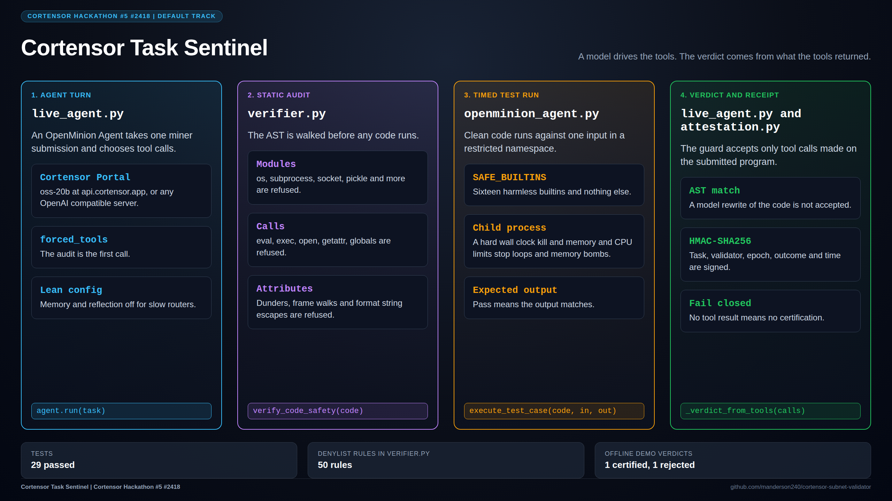
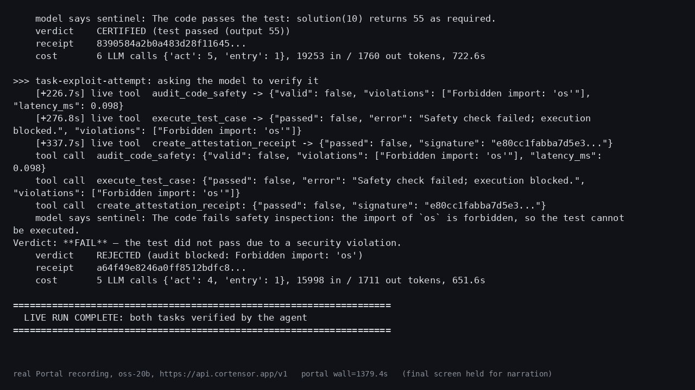

# DoraHacks BUIDL Submission: Cortensor Task Sentinel

**Hackathon**: [Cortensor Hackathon #5 (DoraHacks ID: 2418)](https://dorahacks.io/hackathon/2418/detail)  
**Track**: Default Track  
**Deadline**: December 18, 2026, 23:59 UTC-8  
**Repository**: https://github.com/manderson240/cortensor-subnet-validator  

This file mirrors what I entered in the DoraHacks form.

---

## Form fields

### Name
```text
Cortensor Task Sentinel
```

### Brief description (98 characters)
```text
OpenMinion agent that checks subnet miner code with a real model. Verdicts come from tool results.
```

### Tags
```text
AI > AI Agents
```

### Team
```text
Mike Anderson
```

### Links
- GitHub: https://github.com/manderson240/cortensor-subnet-validator
- Demo video (141 s, 2560x1440, narrated, includes a replay of a real live Cortensor Portal `oss-20b` run): https://raw.githubusercontent.com/manderson240/cortensor-subnet-validator/main/docs/cortensor_live_demo.mp4
- SDK feedback report: https://github.com/manderson240/cortensor-subnet-validator/blob/main/docs/cortensor_openminion_feedback_report.md
- Logo (1024x1024 PNG): `docs/cortensor_task_sentinel_logo.png`

### Contact
- Telegram: `manderson240`
- Discord: `miked238725`

---

## Description

# Cortensor Task Sentinel

### Why I built this
In Cortensor subnets, miners submit code and task outputs that validators have to check before recording results. Sending raw miner code straight to an LLM is slow, costs tokens on submissions that are obviously broken, and exposes the validator node to unsafe calls (`eval`, `exec`, `os.system`, `subprocess`, sockets) or infinite loops.

### How it works
I built Cortensor Task Sentinel with the OpenMinion 0.1 Python SDK (`openminion` v0.1.24, MIT License). `uv run sentinel --live --provider portal` gives each submission to an `openminion.Agent` backed by live Cortensor Portal (`https://api.cortensor.app/v1`, default `oss-20b`, and any OpenAI-compatible local server also works). The model decides which tools to call:

1. `audit_code_safety`: walks the Python AST in under 0.2 ms and blocks forbidden modules (`os`, `sys`, `subprocess`, `socket`), dangerous builtins (`eval`, `exec`, `open`, `__import__`, `getattr`), and dunder sandbox escapes (`__class__`, `__subclasses__`, `__globals__`).
2. `execute_test_case`: runs code that passed the audit against a test input in a child process with a restricted builtins namespace, a hard wall clock kill, and memory and CPU limits.
3. `create_attestation_receipt`: signs the outcome with an epoch-fenced HMAC-SHA256 signature.

The verdict is computed from the tool results on the submitted code, not from the model's reply. In my test runs the model rewrote the malicious submission (removing `import os`) before testing it in 5 of 10 runs on 0.1.20 and again during 0.1.24 smoke runs, and once it certified the rewrite before I added this check.

The demo video (141 s) replays lines verbatim from a real live run of `uv run sentinel --live --provider portal` against Cortensor Portal (`https://api.cortensor.app/v1`, model `oss-20b`), captured on 2026-11-24 and saved in `docs/live_run_capture.jsonl`. The offline sentinel demo and `uv run pytest -q` (29 passed) are run fresh at render time.

### Visual Architecture & Live Terminal Proof




### Building Blocks Tested
- `Agent` + `agent.run()` with a config file pointing the OpenAI-compatible provider at Ollama, Lemonade, and live Cortensor Portal (`https://api.cortensor.app/v1`).
- `@tool` schemas from type hints, and `@tool(min_scope="READ_ONLY", idempotent=True)`.
- `forced_tools`, sessions, `AgentRunResult.stats` / `metadata`, and `OPENMINION_LLM_DEBUG`.

### What We Learned (details and raw data in the report)
- An agent profile with only `provider` fails every turn: the empty `default_channel` is denied by the inbound authenticity check even in `warn` mode. Setting `default_channel: console` fixes it.
- A session id stays bound to its first channel, so a failed first turn poisons the session id.
- Bare `@tool` blocks non-interactive runs: `agent.run()` returns the approval prompt as the answer.
- A tool returning a dataclass fails the turn with "not JSON serializable", and stats then report `tool_calls: 0, tool_errors: 0`.
- `forced_tools` did not guarantee the call (2 of 20 forced turns ran no tool on 0.1.20, and a 4-call skipped workflow reproduced during 0.1.24 verification).
- One three-tool verification costs 8 to 10 LLM calls (median 9.5 over 20 tasks) on defaults, including 2 freshness-classifier calls that these tasks do not need.
- The default 90 s turn timeout is short for local or decentralized models, and runtime state (6.6 MB) is written to `./.openminion`.
- On live Cortensor Portal (`https://api.cortensor.app/v1`), default OpenMinion pre-turn `auto_fact_extraction` (226.7 s), `entry`, and `freshness_classify` spent 414.0 s on `gemma4` before any tool ran and hit 600 s timeouts, while OpenMinion also disables HTTP retries for Cortensor (`cortensor_portal_no_idempotency`). Disabling `memory_enabled`, `auto_fact_extraction`, and `reflection` in `write_agent_config("portal", ...)` (leaving `thinking` at default, because `thinking: "off"` caused `gemma4` to hit `invalid_task_context_update`), setting a 900 s timeout, and wrapping each task in bounded retries let `oss-20b` complete both verification tasks live end-to-end on Cortensor Portal.
- Suggestions: caller-bound tool arguments, a working minimal config, loud failures in non-interactive runs, a first-class low-overhead flag for slow decentralized routers, clean SQLite handle closing on cancelled turns, and a headless `openminion-core`.

Full report: [docs/cortensor_openminion_feedback_report.md](https://github.com/manderson240/cortensor-subnet-validator/blob/main/docs/cortensor_openminion_feedback_report.md)

### Upstream OpenMinion and Cortensor contributions
- Cortensor Community Projects PR: [cortensor/community-projects#104](https://github.com/cortensor/community-projects/pull/104) (`apps/cortensor-task-sentinel`, MIT License, `openminion==0.1.24`).
- Bug report: [openminion/openminion#733](https://github.com/openminion/openminion/issues/733), a circular import between `openminion.modules.tool.executor` and `modules.tool.registry` (still present in PyPI 0.1.24).
- Fix PR: [openminion/openminion#734](https://github.com/openminion/openminion/pull/734), which defers the `ToolSpec` import in `executor.py` and adds an isolated-import regression test (rebased onto current `dev` `0c99b454` at `d8162d73`, addressing maintainer readability and `CHANGELOG.md` `Unreleased` review feedback. It passes 561 critical-path tests, ruff, and mypy type checks). The maintainer accepted the source fix on 2026-11-26 after an independent review.

### Verification
- 29 unit tests pass in under 5 seconds on `openminion==0.1.24` with no network or model (`tests/test_validator.py`), including a bare `except` loop and a memory bomb that must fail without hanging, four sandbox escape probes (frame walk, format string, `globals()`, `__mro__`), a regression test for the model-rewrite case, one proving a reachable Portal cannot certify wrong code, Portal lean config validation, and bounded Portal retry behavior.
- Live Cortensor Portal receipt and demo video on `openminion==0.1.24`: [outputs/cortensor_portal_run_receipt.json](https://github.com/manderson240/cortensor-subnet-validator/blob/main/outputs/cortensor_portal_run_receipt.json) and [docs/cortensor_live_demo.mp4](https://raw.githubusercontent.com/manderson240/cortensor-subnet-validator/main/docs/cortensor_live_demo.mp4) (`oss-20b` at `https://api.cortensor.app/v1`: `task-fibonacci-10` certified in 6 LLM calls / 722.6 s, `task-exploit-attempt` rejected in 5 LLM calls / 651.6 s on first attempt).
- Live local receipt on `openminion==0.1.24`: [outputs/live_model_run_receipt.json](https://github.com/manderson240/cortensor-subnet-validator/blob/main/outputs/live_model_run_receipt.json) (`gpt-oss:20b-cloud`: honest task certified in 10 LLM calls / 24.7 s, `os.system` exploit blocked in 9 LLM calls / 34.9 s).
- 20 recorded live agent turns (`openminion==0.1.20`): correct verdict on 19, the exploit never certified. The miss was a skipped workflow that failed closed (`docs/live_reliability.json`).

### Limits
- The model does not always finish the workflow. It sometimes replies without calling a tool, and those runs fail closed with no certification.
- A live Portal task takes 5 to 6 LLM calls and over 10 minutes per task on `oss-20b`.
- The safety check is a static denylist plus a child process with a wall clock kill and memory and CPU limits, not a full sandbox. The child shares the host filesystem and network, so a production validator should add a container.
- The resource limits need Unix.

The full list is in the README under Limits.

### Future roadmap
- Merge upstream contributions (`openminion/openminion#734` circular import fix and `cortensor/community-projects#104` app submission).
- Add caller-bound argument validation helpers in OpenMinion policies so validators can pin submitted code hashes before execution.
- Expand deterministic sandbox rules and support batch subnet task queueing for continuous Cortensor validator nodes.

```bash
git clone https://github.com/manderson240/cortensor-subnet-validator.git
cd cortensor-subnet-validator
uv run pytest
uv run sentinel --live --provider portal          # live Cortensor Portal with CORTENSOR_API_KEY
SENTINEL_MODEL=gpt-oss:20b-cloud uv run sentinel --live   # any local OpenAI-compatible server
```

---

## Architecture diagrams

See [README.md](README.md#architecture) for the flowchart, sequence diagram, and state diagram.
