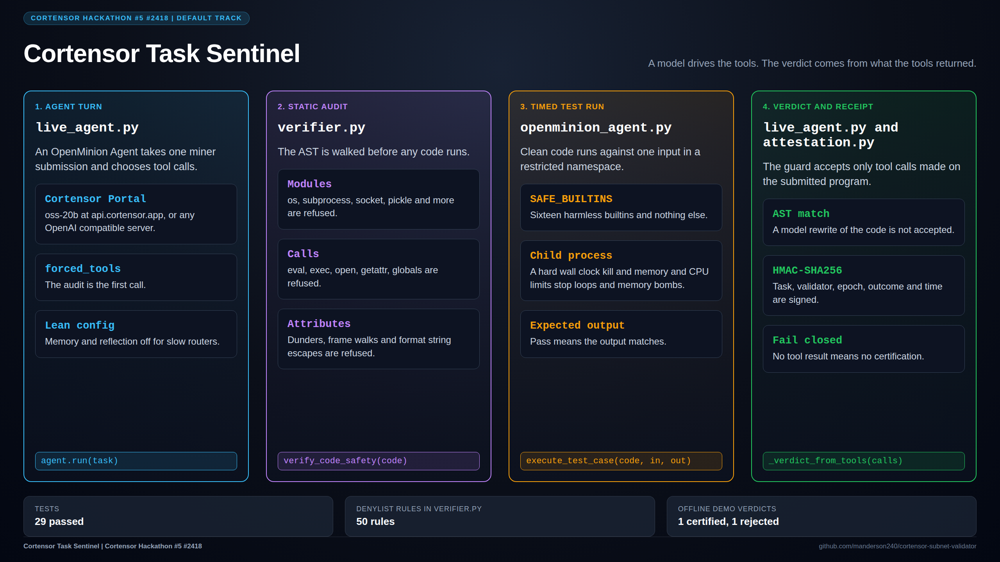
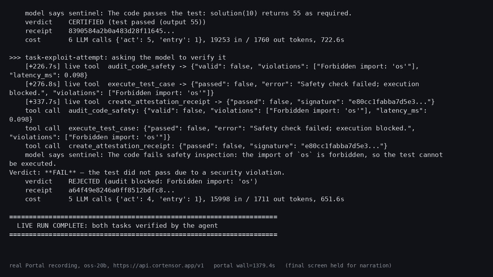
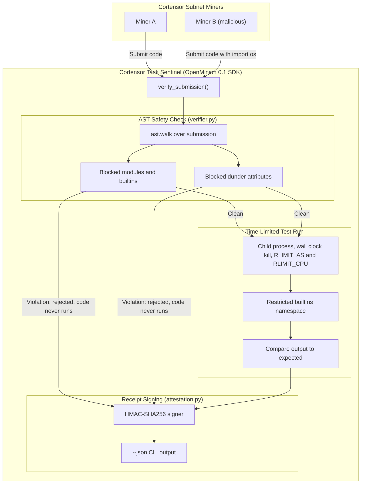
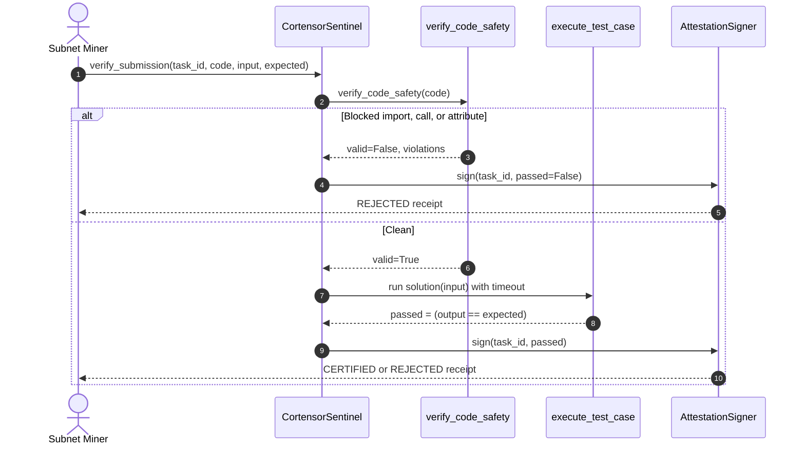
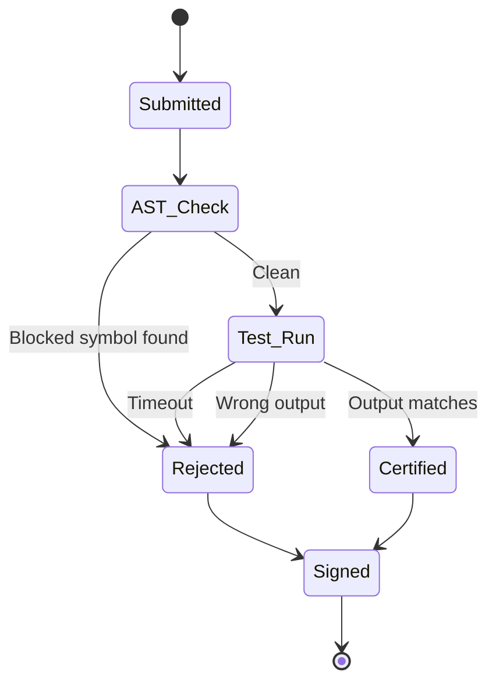

# Cortensor Task Sentinel

<p align="center">
  
</p>

A subnet task verification agent I built with the OpenMinion 0.1 Python SDK (`openminion` v0.1.24, first prototyped on v0.1.20) for [Cortensor Hackathon #5 on DoraHacks (ID: 2418)](https://dorahacks.io/hackathon/2418/detail).

Miners in a Cortensor subnet submit code that validators have to check before recording results. An OpenMinion agent backed by a real model takes each submission and decides which tools to call: a static AST safety audit, a time-limited test run, and an HMAC-signed receipt. The verdict is computed from the tool results on the submitted code, never from the model's reply, because in my test runs the model sometimes rewrote the code it was checking (see Limits).



Demo video (141 s, 2560x1440, narrated, includes a replay of a real live Cortensor Portal run): [`docs/cortensor_live_demo.mp4`](https://raw.githubusercontent.com/manderson240/cortensor-subnet-validator/main/docs/cortensor_live_demo.mp4)

---

## Quickstart

```bash
git clone https://github.com/manderson240/cortensor-subnet-validator.git
cd cortensor-subnet-validator
uv sync

# Live run: the agent verifies one honest and one malicious submission with a real model.
# Any OpenAI-compatible server works. With Ollama (default base URL http://localhost:11434/v1):
SENTINEL_MODEL=gpt-oss:20b-cloud uv run sentinel --live

# Another OpenAI-compatible server (vLLM, llama.cpp server, Lemonade, ...)
SENTINEL_BASE_URL=http://localhost:8000/v1 SENTINEL_MODEL=<model-id> uv run sentinel --live

# Cortensor Portal preset (oss-20b at https://api.cortensor.app/v1); needs CORTENSOR_API_KEY
uv run sentinel --live --provider portal

# Deterministic path without a model (fast; no tokens)
uv run sentinel
uv run sentinel --code-file path/to/proposal.py --task-id task-custom-01 --input 10 --expected 55 --json

# Tests (no network, no model)
uv run pytest
```

### Live run output

From `docs/live_run_capture.jsonl`, captured live against Cortensor Portal (`https://api.cortensor.app/v1`, model `oss-20b`) and shown in `docs/cortensor_live_demo.mp4`. Disabling OpenMinion's pre-turn reflection and memory extraction and raising the Portal timeout to 900 s allowed both verification tasks to finish end-to-end on the first attempt (`5` to `6` LLM calls per task instead of `9` to `10`).



```text
$ uv run sentinel --live --provider portal
====================================================================
  CORTENSOR TASK SENTINEL, live model run (OpenMinion 0.1 SDK)
  provider=portal  model=oss-20b  base_url=https://api.cortensor.app/v1
  portal     connected=True  models=['gemma4', 'oss-120b', 'oss-20b', 'qwen']
====================================================================

>>> task-fibonacci-10: asking the model to verify it
    [+214.0s] live tool  audit_code_safety -> {"valid": true, "violations": [], "latency_ms": 0.134}
    [+281.4s] live tool  execute_test_case -> {"passed": true, "actual_output": 55, "latency_ms": 0.079}
    [+368.7s] live tool  create_attestation_receipt -> {"passed": true, "signature": "fa9ba2824c2ab60e..."}
    tool call  audit_code_safety: {"valid": true, "violations": [], "latency_ms": 0.134}
    tool call  execute_test_case: {"passed": true, "actual_output": 55, "latency_ms": 0.079}
    tool call  create_attestation_receipt: {"passed": true, "signature": "fa9ba2824c2ab60e..."}
    model says sentinel: The code passes the test: solution(10) returns 55 as required.
    verdict    CERTIFIED (test passed (output 55))
    receipt    8390584a2b0a483d28f11645...
    cost       6 LLM calls {'act': 5, 'entry': 1}, 19253 in / 1760 out tokens, 722.6s

>>> task-exploit-attempt: asking the model to verify it
    [+226.7s] live tool  audit_code_safety -> {"valid": false, "violations": ["Forbidden import: 'os'"], "latency_ms": 0.098}
    [+276.8s] live tool  execute_test_case -> {"passed": false, "error": "Safety check failed; execution blocked.", "violations": ["Forbidden import: 'os'"]}
    [+337.7s] live tool  create_attestation_receipt -> {"passed": false, "signature": "e80cc1fabba7d5e3..."}
    tool call  audit_code_safety: {"valid": false, "violations": ["Forbidden import: 'os'"], "latency_ms": 0.098}
    tool call  execute_test_case: {"passed": false, "error": "Safety check failed; execution blocked.", "violations": ["Forbidden import: 'os'"]}
    tool call  create_attestation_receipt: {"passed": false, "signature": "e80cc1fabba7d5e3..."}
    model says sentinel: The code fails safety inspection: the import of `os` is forbidden, so the test cannot be executed.
Verdict: **FAIL** - the test did not pass due to a security violation.
    verdict    REJECTED (audit blocked: Forbidden import: 'os')
    receipt    a64f49e8246a0ff8512bdfc8...
    cost       5 LLM calls {'act': 4, 'entry': 1}, 15998 in / 1711 out tokens, 651.6s

====================================================================
  LIVE RUN COMPLETE: both tasks verified by the agent
====================================================================
```

For reliability across repeated runs (19 of 20 local agent turns passing, and how the AST guard catches model rewrites in 5 of 10 exploit turns), see section 5 of the
[feedback report](docs/cortensor_openminion_feedback_report.md).

---

## How it works

`sentinel --live` builds an `openminion.Agent` from a generated `agents.json` (OpenAI-compatible provider, `default_channel: console`) and runs one `agent.run()` turn per task ([`live_agent.py`](src/cortensor_validator/live_agent.py)). The SDK's `forced_tools` makes the audit the first call. After that the model decides whether to run the test and what to attest. Every tool call is logged with the code it was called on, and `_verdict_from_tools` only accepts calls on the submitted program (compared by AST, so reformatting is fine and a removed import is not). A blocked audit is final.

The tools are `@tool(min_scope="READ_ONLY", idempotent=True)` functions in [`src/cortensor_validator/openminion_agent.py`](src/cortensor_validator/openminion_agent.py):

1. `audit_code_safety` parses the submission with Python's `ast` module and rejects it if it imports a blocked module (`os`, `sys`, `subprocess`, `socket`, `ctypes`, `pickle`, and others), calls a blocked builtin (`eval`, `exec`, `open`, `__import__`, `getattr`, and others), or touches a dunder attribute used for sandbox escapes (`__class__`, `__subclasses__`, `__globals__`, `__code__`). The lists live in [`verifier.py`](src/cortensor_validator/verifier.py).
2. `execute_test_case` runs code that passed the audit against an input and expected output. It runs the code in a child process with a restricted builtins namespace, a hard wall clock kill from the parent, and `RLIMIT_AS` (512 MB) and `RLIMIT_CPU` set in the child. A loop that swallows exceptions or a memory bomb fails the test case with an error string, it never hangs or kills the validator.
3. `verify_via_hosted_portal` reports whether the Cortensor Portal API answers with your key and runs the test locally. Portal is an OpenAI-compatible model endpoint, so a reachable Portal is never treated as a verdict. (An earlier version did treat it as one. That is fixed and covered by `test_reachable_portal_does_not_certify_wrong_code`.) The live agent does not use this tool.
4. `create_attestation_receipt` signs the result with HMAC-SHA256 over task ID, validator ID, epoch, outcome, and timestamp. See [`attestation.py`](src/cortensor_validator/attestation.py).

The deterministic path (`uv run sentinel`, `--code-file`) runs the same audit, test and signing without a model.

### Architecture



### Verification sequence



### Submission states



---

## Configuration

| Variable | Description | Default |
|---|---|---|
| `CORTENSOR_VALIDATOR_ID` | Validator node identifier | `val-cortensor-01` |
| `CORTENSOR_EPOCH` | Current epoch, included in each signature | `1` |
| `CORTENSOR_SECRET_KEY` | HMAC signing key. Set your own; the default is for local demos only. | `cortensor_subnet_secret_key_2026` |
| `SENTINEL_MODEL` | Model id for `--live` (required for the `local` preset) | unset |
| `SENTINEL_BASE_URL` | OpenAI-compatible base URL for `--live` | `http://localhost:11434/v1` (local), `https://api.cortensor.app/v1` (portal) |
| `SENTINEL_API_KEY` | Key for the `local` preset, if your server needs one | unset |
| `CORTENSOR_API_KEY` | Key for the `portal` preset and the Portal reachability check | unset |
| `CORTENSOR_BASE_URL` | Hosted API base URL | `https://api.cortensor.app` |

---

## Tests

```bash
uv run pytest
```

29 tests in [`tests/test_validator.py`](tests/test_validator.py), passing in under 5 seconds with no network or model calls. They cover the AST audit and evasion attempts (including frame, format string and `globals()` escapes found by probing the denylist), HMAC signing and tamper detection, the timeout, a bare `except` loop that swallows the timer and a memory bomb (both must fail the case without hanging or killing pytest), the CLI and `--json`, the Portal check (a reachable Portal must not certify wrong code), the live verdict logic (including a model that rewrites the submission, seen in a real run), the Portal lean runtime configuration, bounded Portal retries, and the generated agent config.

---

## Limits

- The model does not always finish the workflow. In my runs it sometimes replied "I could not safely update the task conditions" without calling a tool (2 of 20 local honest-task turns across my two recorded batches, and on Portal `gemma4` when `thinking: "off"` was set). Those runs fail closed: no tool result, no certification.
- The model chooses tool arguments and sometimes passed reformatted or rewritten code. The verdict guard handles this, but a model can still waste a turn.
- On live Cortensor Portal (`https://api.cortensor.app/v1`) with `openminion==0.1.24` ([`outputs/cortensor_portal_run_receipt.json`](outputs/cortensor_portal_run_receipt.json)), default OpenMinion settings spend up to `414s` in pre-turn reflection/classification before any Sentinel tool runs and hit `600s` timeouts. With `write_agent_config("portal", ...)` disabling `memory_enabled`, `auto_fact_extraction`, and `reflection` and setting a `900s` turn timeout, `oss-20b` completed both tasks cleanly (`722.6s` certified, `651.6s` rejected). OpenMinion also disables HTTP retries for the Cortensor vendor (`cortensor_portal_no_idempotency`), so `sentinel.py` wraps each Portal task in up to 3 bounded retries in case a decentralized miner returns HTTP 500/502 or a malformed tool schema.
- A live task costs `5` to `6` LLM calls on Portal (with reflection disabled) or `8` to `10` LLM calls and roughly 20,000 input tokens on default settings.
- The safety check is a static denylist plus a child process with a wall clock kill and address space and CPU limits, not a full sandbox. It stops the common escape routes and obvious resource abuse, but the child still shares the host filesystem and network, so a production validator should run untrusted code in a container as well. The resource limits use the `resource` module, so the test run needs Unix.

---

## Future roadmap

- Merge upstream contributions (`openminion/openminion#734` circular import fix and `cortensor/community-projects#104` app submission).
- Add caller-bound argument validation helpers in OpenMinion policies so validators can pin submitted code hashes before execution.
- Expand deterministic sandbox rules and support batch subnet task queueing for continuous Cortensor validator nodes.

## Hackathon deliverables

- Demo video: [`docs/cortensor_live_demo.mp4`](https://raw.githubusercontent.com/manderson240/cortensor-subnet-validator/main/docs/cortensor_live_demo.mp4) (141 s, 2560x1440, narrated). It replays lines verbatim from the real live run on Cortensor Portal `oss-20b` captured on 2026-11-24 by [`scripts/record_live_demo.py`](scripts/record_live_demo.py) (raw capture: `docs/live_run_capture.jsonl`), and shows fresh runs of `uv run sentinel` and `uv run pytest -q`
- OpenMinion SDK feedback report: [`docs/cortensor_openminion_feedback_report.md`](docs/cortensor_openminion_feedback_report.md)
- Community Projects PR: [cortensor/community-projects#104](https://github.com/cortensor/community-projects/pull/104)
- Upstream bug report: [openminion/openminion#733](https://github.com/openminion/openminion/issues/733), a circular import between `openminion.modules.tool.executor` and `openminion.modules.tool.registry`
- Upstream fix PR: [openminion/openminion#734](https://github.com/openminion/openminion/pull/734), which defers the `ToolSpec` import in `executor.py` and adds an isolated-import regression test

## License

MIT
