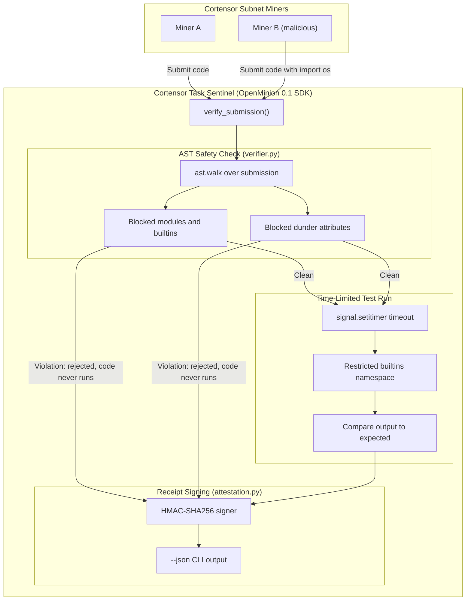
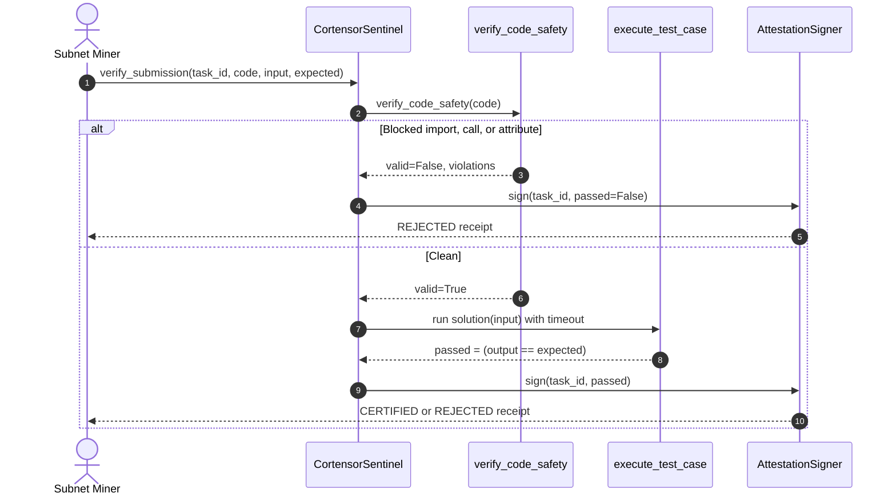
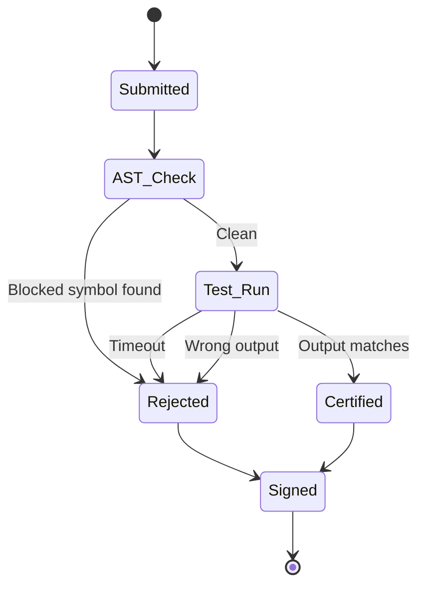

# Cortensor Task Sentinel

<p align="center">
  
</p>

A subnet task verification agent I built with the OpenMinion 0.1 Python SDK (`openminion` v0.1.20) for [Cortensor Hackathon #5 on DoraHacks (ID: 2418)](https://dorahacks.io/hackathon/2418/detail).

Miners in a Cortensor subnet submit code that validators have to check before recording results. This agent runs a static AST safety check, a time-limited test run, and an HMAC-signed receipt for each submission. The safety check runs in under 0.2 ms and uses no LLM tokens.

---

## Quickstart

```bash
git clone https://github.com/manderson240/cortensor-subnet-validator.git
cd cortensor-subnet-validator
uv sync

# Run the demo (one honest submission, one malicious submission)
uv run sentinel

# Verify your own file
uv run sentinel --code-file path/to/proposal.py --task-id task-custom-01 --input 10 --expected 55

# Same, with a JSON receipt
uv run sentinel --code-file path/to/proposal.py --json

# Run the tests
uv run pytest
```

### Demo output (trimmed: session ID and signature lines removed)

```text
====================================================================
  CORTENSOR TASK SENTINEL (OpenMinion 0.1 SDK)
  DoraHacks Hackathon #5: Subnet Task Verification Agent
====================================================================

[1] Initialized OpenMinion Agent: 'CortensorSentinel-val-cortensor-node-01'
    - Tools registered: audit_code_safety, execute_test_case, verify_via_hosted_portal, create_attestation_receipt

[2] Ingesting Subnet Task: 'task-fibonacci-10'
    - Solution Proposal: Pure iterative Fibonacci algorithm
    [OK] Safety Audit:      PASSED (0 forbidden calls)
    [OK] Correctness Test:  PASSED (solution(10) == 55) [local]
    [OK] Verified Status:   CERTIFIED

[3] Ingesting Adversarial Task: 'task-exploit-attempt'
    - Solution Proposal: Contains unauthorized 'import os'
    [OK] Safety Audit:      BLOCKED (Forbidden import 'os' detected)
    [OK] Execution:         PREVENTED (code never ran)
    [OK] Verified Status:   REJECTED

====================================================================
  SENTINEL COMPLETE: ALL CHECKS PASSED in 0.4ms
====================================================================
```

Timing varies by machine. On my desktop the full demo cycle takes about 0.4 ms.

---

## How it works

The agent is an `openminion.Agent` with four `@tool` functions, all in [`src/cortensor_validator/openminion_agent.py`](src/cortensor_validator/openminion_agent.py):

1. `audit_code_safety` parses the submission with Python's `ast` module and rejects it if it imports a blocked module (`os`, `sys`, `subprocess`, `socket`, `ctypes`, `pickle`, and others), calls a blocked builtin (`eval`, `exec`, `open`, `__import__`, `getattr`, and others), or touches a dunder attribute used for sandbox escapes (`__class__`, `__subclasses__`, `__globals__`, `__code__`). The lists live in [`verifier.py`](src/cortensor_validator/verifier.py).
2. `execute_test_case` runs code that passed the audit against an input and expected output. It uses a restricted builtins namespace and a `signal.setitimer` timeout so infinite loops get cut off.
3. `verify_via_hosted_portal` calls the hosted Cortensor API when `CORTENSOR_API_KEY` is set and falls back to local verification otherwise.
4. `create_attestation_receipt` signs the result with HMAC-SHA256 over task ID, validator ID, epoch, outcome, and timestamp. See [`attestation.py`](src/cortensor_validator/attestation.py).

The safety audit always runs locally first, even in hosted mode, so a malicious submission is rejected before it reaches the network or the executor.

### Architecture



### Verification sequence



### Submission states



---

## Configuration

| Variable | Description | Default |
|---|---|---|
| `CORTENSOR_VALIDATOR_ID` | Validator node identifier | `val-cortensor-01` |
| `CORTENSOR_EPOCH` | Current epoch, included in each signature | `1` |
| `CORTENSOR_SECRET_KEY` | HMAC signing key. Set your own; the default is for local demos only. | `cortensor_subnet_secret_key_2026` |
| `CORTENSOR_API_KEY` | Enables hosted portal verification | unset |
| `CORTENSOR_BASE_URL` | Hosted API base URL | `https://api.cortensor.app` |

---

## Tests

```bash
uv run pytest
```

17 tests in [`tests/test_validator.py`](tests/test_validator.py), passing in under 2 seconds with no network or paid API calls. They cover:

- Clean code passes, blocked imports and builtins are rejected, syntax errors are caught
- Evasion attempts: dynamic `getattr` imports and `__class__` / `__subclasses__` access
- HMAC signing, tamper detection, and epoch handling
- OpenMinion `@tool` registration and `Agent` creation
- Environment variable overrides
- File verification and `--json` output from the CLI
- Timeout enforcement on an infinite loop
- Hosted portal fallback when no API key is set, and a mocked connected case

---

## Limits

This is a static denylist plus a time limit, not a full sandbox. It stops the common escape routes and obvious resource abuse, but a production validator should still run untrusted code in a separate process or container. The `signal.setitimer` timeout only works on the main thread of a Unix process.

---

## Hackathon deliverables

- Demo video: [`docs/cortensor_pitch_demo.mp4`](docs/cortensor_pitch_demo.mp4), generated with `python3 scripts/generate_pitch_video.py`
- OpenMinion SDK feedback report: [`docs/cortensor_openminion_feedback_report.md`](docs/cortensor_openminion_feedback_report.md)
- Upstream bug report: [openminion/openminion#733](https://github.com/openminion/openminion/issues/733), a circular import between `openminion.modules.tool.executor` and `openminion.modules.tool.registry`
- Upstream fix PR: [openminion/openminion#734](https://github.com/openminion/openminion/pull/734), which defers the `ToolSpec` import in `executor.py` and adds an isolated-import regression test

## License

MIT
